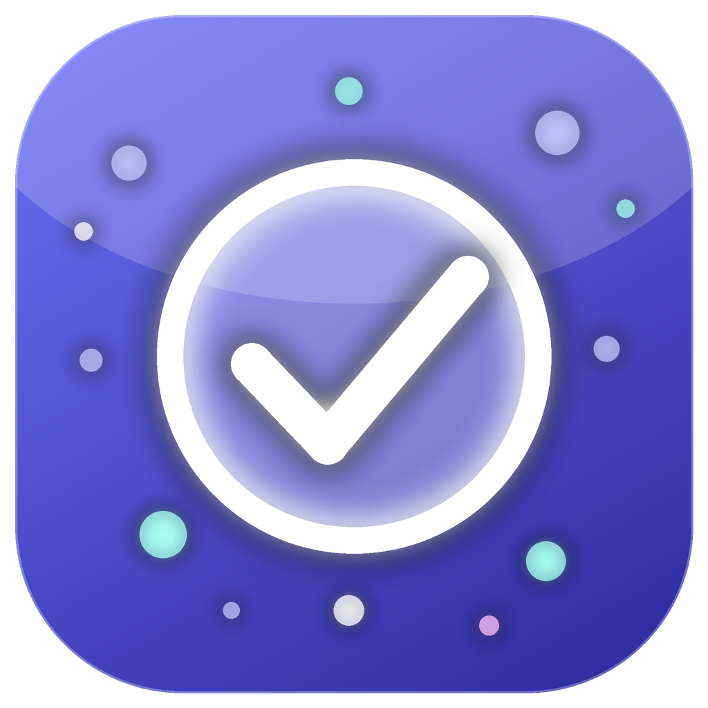

# Discord Quest Completer (v2.1)

<p align="center">
  
</p>

<p align="center">
  <b>Complete Discord Quests and show any game as "Playing" without installing it.</b><br>
  Windows and Linux. Modern GUI and CLI. 25,000+ games from Discord's own detectable-games database.
</p>

<p align="center">
  <a href="../../releases/latest"></a>
  <a href="LICENSE"></a>
  
  
</p>

**Discord Quest Completer** (formerly *Discord Orbs Earner*) is an experimental tool that parses Discord's detectable-games database and runs mock game instances ("spoofing") so the Discord desktop client believes a game is running. Use it to test Discord Quests, game detection and Rich Presence without downloading or installing the actual games.

> [!WARNING]
> **Read before use.** This is an experimental tool provided "as is" for educational and research purposes. It is **not intended** for profit, automated farming, or circumventing Discord's Terms of Service, and you are responsible for complying with them. Faking activity may get your account flagged or banned. You use this software entirely at your own risk. This project is not affiliated with or endorsed by Discord Inc.

## Features

- **25,387 games** from Discord's `applications/detectable` endpoint, including games that have no executable in the database yet (unreleased titles such as *Grand Theft Auto VI*).
- **Two spoofing modes**
  - **Process mode**: a tiny dummy process named exactly like the game executable, created at the full relative path Discord expects (`win64/game.exe`, `_retail_/wow-64.exe`, ...).
  - **RPC mode** (automatic for games without a known executable): registers Rich Presence for the real Discord application ID through the local Discord IPC socket.
- **Cross-platform**: a native zero-metadata C# runner on Windows, and a plain system process on Linux (works with the uutils-based `sleep` of newer Ubuntu too).
- **Fast**: the processed game list is cached on disk and shown instantly on start, then refreshed in the background (ETag check). Search is debounced, results are paginated and also match game aliases (for example `gta 6`).
- **Modern split-screen GUI** (Flet) with live system log and per-game settings (executable, window title), plus a **CLI** mode (`--cli`).
- **English by default**, Russian included (switch in the top-right corner).

## Requirements

- Windows or Linux, Python 3.10+ (only when running from source).
- The Discord **desktop** client running on the same machine (required for Quest detection and RPC).
- Linux: `python3-venv`, and `libmpv2` is recommended for the Flet desktop client.

## Installation and usage

Download the latest standalone build for Windows or Linux from the [Releases](../../releases/latest) page, or run from source:

**Windows**

1. Clone the repository.
2. Double-click `run.bat`. It creates a virtual environment, installs the dependencies and starts the app.

**Linux**

```bash
git clone https://github.com/milkycloud-dev/discord-quest-completer.git
cd discord-quest-completer
./run.sh
```

**Manually**

```bash
pip install -r requirements.txt
python src/app.py          # GUI
python src/app.py --cli    # command line
```

Search for a game, click **Play** once, and keep the app running while Discord sees the game. Click **Stop** (or close the app) to end it.

## How it works

Discord's client scans running processes and matches them with the `executables` list from `https://discord.com/api/v9/applications/detectable`. The tool creates a harmless sleeping process whose path ends exactly with the registered executable name, so Discord reports the game as running. For titles with an empty `executables` list there is nothing to match, so the tool talks to the local Discord IPC socket (`discord-ipc-0`) and registers an activity for the real application ID instead.

## Limitations

- Console Quests (PlayStation, Xbox) need a real linked console account and cannot be emulated by this tool.
- A few executables are shared by many games (for example Source engine `>hl2.exe`) and Discord does not recognise them from a dummy process.
- RPC mode sets Rich Presence only. Whether a Quest is credited for it depends on Discord and may change at any time.
- Discord can change its detection at any time.

## License

Released under the [MIT License](LICENSE). The icon is an original design and does not use Discord's logo.

## Credits

The idea of an RPC mode is inspired by [markterence/discord-quest-completer](https://github.com/markterence/discord-quest-completer). This project is independent and shares no code with it.

## Keywords

discord quest completer, discord quests, discord orbs, complete discord quests without installing games, discord game spoofing, discord rich presence spoofer, discord rpc, discord detectable games, fake game for discord, discord quest farm tool, flet, python, windows, linux.

---

# Discord Quest Completer (v2.1 - RU)

<p align="center">
  
</p>

**Discord Quest Completer** (раньше *Discord Orbs Earner*) — экспериментальная утилита для Windows и Linux: парсит базу игр Discord и запускает фиктивные процессы («спуфинг»), чтобы клиент Discord считал, что игра запущена. Подходит для проверки заданий (Quests), определения игр и Rich Presence без установки самих игр.

> [!WARNING]
> **ВНИМАНИЕ! ПРОЧТИТЕ ПЕРЕД ИСПОЛЬЗОВАНИЕМ.** Программа предоставляется «как есть» исключительно в образовательных и исследовательских целях. Она **не предназначена** для коммерческих целей, автоматизированного фарминга или обхода Правил использования (Terms of Service) Discord, ответственность за их соблюдение лежит на вас. Имитация активности может привести к блокировке аккаунта. Вы используете софт на свой страх и риск. Проект не связан с Discord Inc.

## Особенности

- **25 387 игр** из базы Discord (`applications/detectable`), включая игры без exe в базе (например, *Grand Theft Auto VI*).
- **Два режима**: фиктивный процесс с полным путём к exe (`win64/game.exe`) и **RPC-режим** (автоматически для игр без exe): Rich Presence с настоящим ID приложения через локальный IPC Discord.
- **Windows и Linux**: нативный C# раннер на Windows и обычный системный процесс на Linux.
- **Быстро**: обработанный список игр кэшируется и показывается мгновенно, обновление идёт в фоне. Поиск с задержкой, постраничный вывод, поиск по алиасам (`gta 6`).
- **GUI на Flet** с системным логом и настройками игры, плюс **CLI** (`--cli`).
- **Английский язык по умолчанию**, русский переключается в правом верхнем углу.

## Требования

- Windows или Linux, Python 3.10+ (только для запуска из исходников).
- Запущенный **десктопный** клиент Discord на этой же машине.
- Linux: `python3-venv`, для клиента Flet желателен `libmpv2`.

## Установка и использование

Скачайте готовую сборку со страницы [Releases](../../releases/latest) или запустите из исходников:

- **Windows**: клонируйте репозиторий и запустите `run.bat` (создаст окружение, поставит зависимости и откроет приложение).
- **Linux**: `./run.sh`.
- **Вручную**: `pip install -r requirements.txt`, затем `python src/app.py` (или `python src/app.py --cli`).

Найдите игру, нажмите **Играть** один раз и держите приложение запущенным, пока Discord видит игру.

## Ограничения

- Консольные задания (PlayStation, Xbox) требуют реально привязанной консоли, эмулировать их нельзя.
- Несколько общих exe (например, `>hl2.exe` движка Source) Discord по фиктивному процессу не распознаёт.
- RPC-режим только выставляет Rich Presence: засчитается ли задание, решает Discord.

## Лицензия

MIT, см. [LICENSE](LICENSE). Иконка нарисована с нуля и не использует логотип Discord.
